# Ram's Gym

**A strength-training diary for Android that plans your progress from what you actually lifted.**

Log every set, record cardio in the gym and runs outdoors, run load cycles, see your records and get honest numbers about your training — offline, on your phone. Friends, a shared feed, likes and comments are there when you want them.

  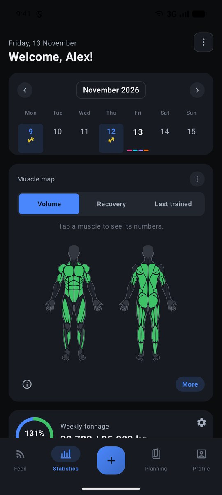
  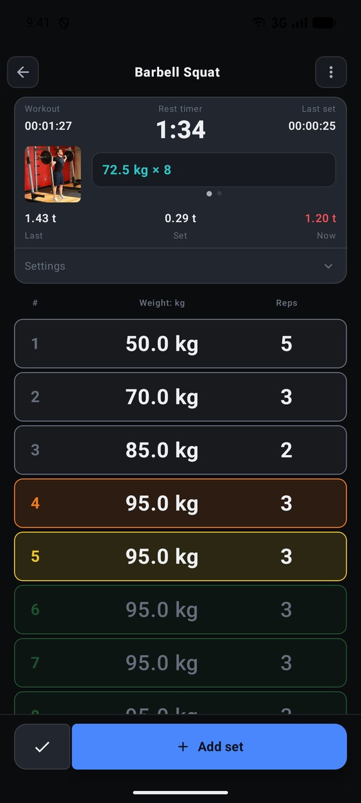
  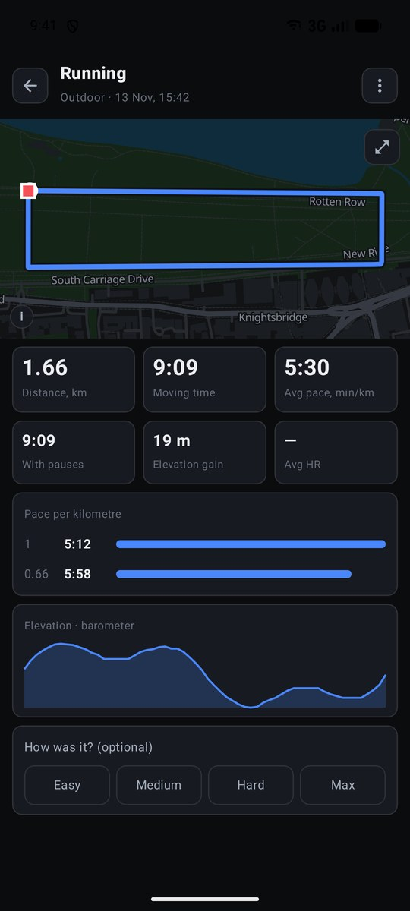
  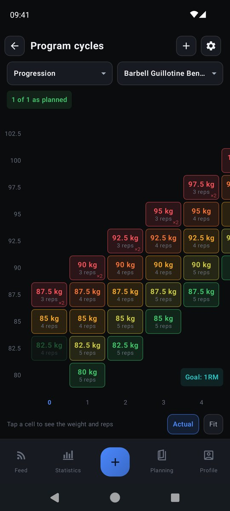

  <a href="https://github.com/Ramzesp2009/ramsgym-realses/releases/latest"><b>⬇ Download the latest APK</b></a>
  &nbsp;·&nbsp; Android 10 or newer &nbsp;·&nbsp; English, Ukrainian and German

---

## Contents

- [What makes it different](#what-makes-it-different)
- [Statistics](#statistics)
- [The workout](#the-workout)
- [Cardio and runs](#cardio-and-runs)
- [Workout summary and history](#workout-summary-and-history)
- [Planning](#planning)
- [Program wizard](#program-wizard)
- [Load cycles (periodization)](#load-cycles-periodization)
- [Analysis](#analysis)
- [Records](#records)
- [Feed and friends](#feed-and-friends)
- [Profile and settings](#profile-and-settings)
- [Install and update](#install-and-update)
- [Privacy](#privacy)
- [License](#license)

---

## What makes it different

- **Offline first.** Every workout, program and cycle lives in a local database on your phone. No account is needed to train; the account only adds friends and the feed.
- **One workout, whatever you do.** Weights, a treadmill and a run outdoors can all sit in the same workout — friends get one start and one finish.
- **The plan follows the lifter, not the lifter the plan.** A load cycle reads where you stand from the weights you actually lifted — go heavier than planned and the plan moves forward with you; miss twice and it offers a light day instead of more weight.
- **Numbers you can trust.** 1RM is estimated only up to 10 reps (Brzycki) — above that the app says there is no value rather than invent one. Tonnage means *working* tonnage: warm-up sets are counted separately.
- **It explains, it does not decide.** Rest times, warm-up ramps, weekly volume — every rule the app uses is written down in *Guides* with its sources and what happens if you change it. Recommendations are text; nothing changes without you.
- **A tip a day.** 100 short tips on training, nutrition, mobility, recovery and cycles — a new one each day under every finished workout and on the Planning screen.

---

## Statistics

The start screen is a list of cards you arrange yourself: the calendar, a muscle map, the weekly tonnage goal, sleep and activity from Health Connect, and four tabs — charts, goals, analysis and achievements.

<table>
  <tr>
    <td width="33%"></td>
    <td width="33%">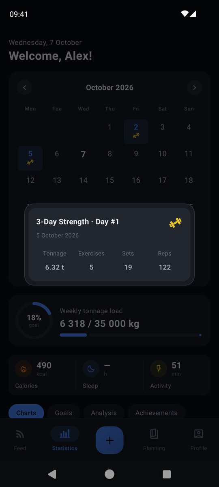</td>
    <td width="33%"></td>
  </tr>
  <tr>
    <td><b>Calendar and muscle map.</b> Each training day carries a dumbbell coloured by how hard the workout was — the share of hard working sets, not an average. Swipe the calendar up to fold it to one week. Up to four friends show as coloured bars under the days they trained. The muscle map shows weekly volume, recovery and what hasn’t been trained for a while.</td>
    <td><b>A day in the calendar.</b> Tap a day to see its workouts: tonnage, exercises, sets and reps. Tap the card to open the full summary.</td>
    <td><b>The year.</b> Tap the month name to see twelve months on one screen — yours or a friend's: workouts, per week, tonnage and hours in the gym, each day coloured by difficulty.</td>
  </tr>
  <tr>
    <td></td>
    <td></td>
    <td></td>
  </tr>
  <tr>
    <td><b>Three ways to see a year.</b> Twelve small calendars, a strip of weeks with the longest break, or months as bars — switched in the ⋮ menu.</td>
    <td><b>Charts.</b> One bar per workout on its date: program tonnage coloured by program day, over 1, 3, 6 or 12 months, with arrows through the whole history and a full-screen landscape view.</td>
    <td><b>An exercise over time.</b> The heaviest set and the tonnage of any exercise, and the tonnage of a single program day.</td>
  </tr>
  <tr>
    <td>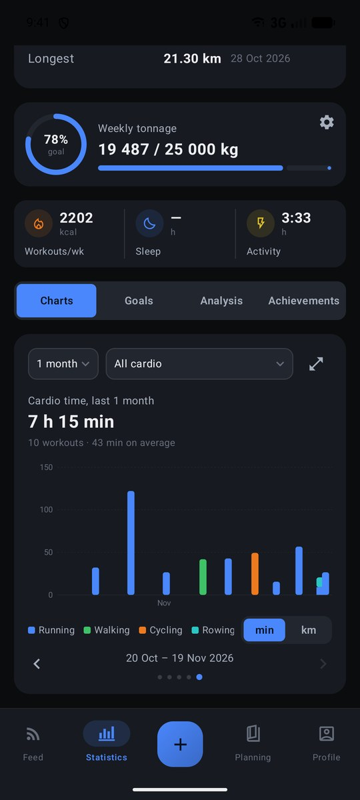</td>
    <td>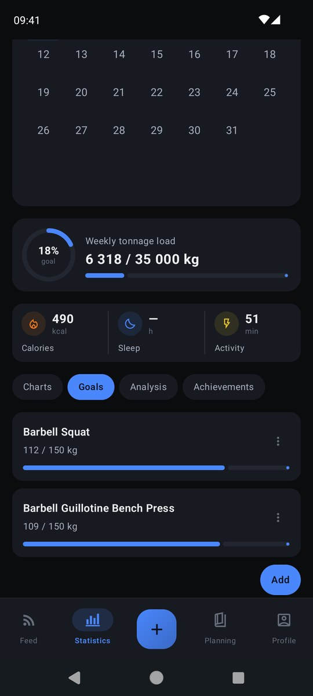</td>
    <td>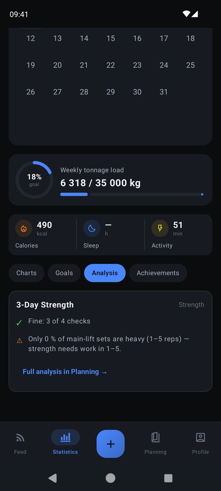</td>
  </tr>
  <tr>
    <td><b>Cardio chart.</b> The fifth page of the charts: minutes or kilometres of cardio per workout, each kind in its own colour — running, walking, cycling and every machine.</td>
    <td><b>Goals.</b> A goal is either a 1RM (“150 kg max”) or weight for reps (“100 kg × 10”). Tap a goal to open the workout where its current best was set.</td>
    <td><b>Analysis at a glance.</b> A short summary of the program check; the full report lives in Planning.</td>
  </tr>
  <tr>
    <td>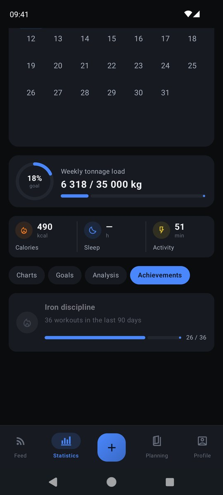</td>
    <td>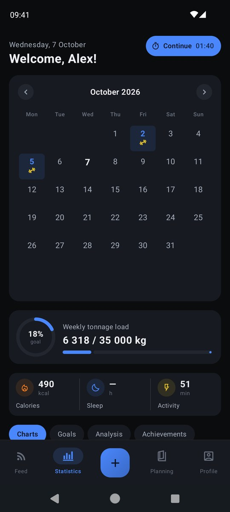</td>
    <td>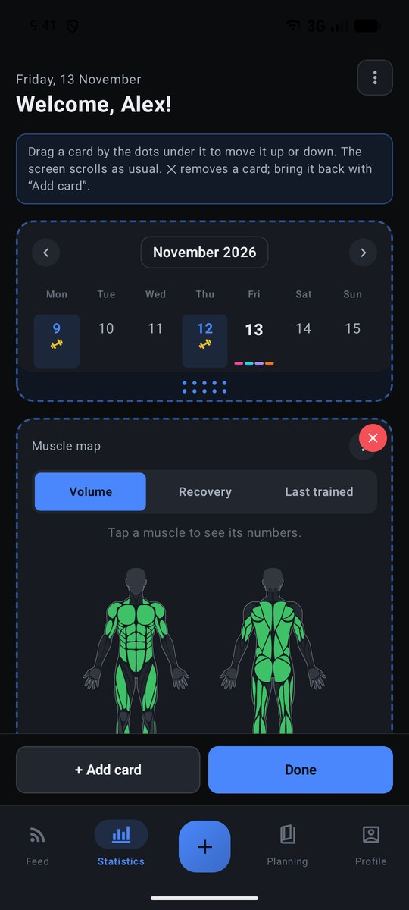</td>
  </tr>
  <tr>
    <td><b>Achievements</b> with their progress bars.</td>
    <td><b>Continue.</b> While a workout is running, a pill with its timer sits in the corner of every tab and brings you back exactly where you stopped.</td>
    <td><b>Customize layout.</b> Drag cards by the handle under them, remove the ones you don’t need and bring them back with “Add card”.</td>
  </tr>
</table>

---

## The workout

<table>
  <tr>
    <td width="33%">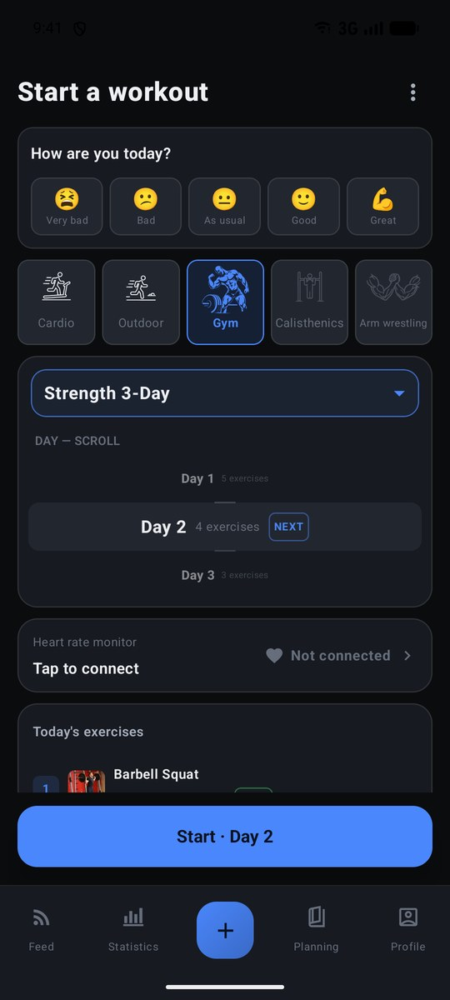</td>
    <td width="33%">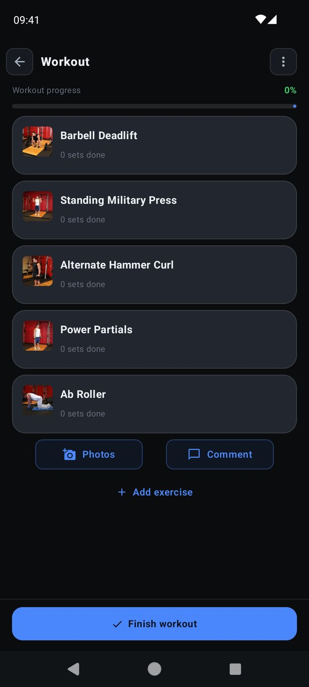</td>
    <td width="33%"></td>
  </tr>
  <tr>
    <td><b>Start a workout.</b> Tiles pick the kind: gym, indoor cardio or outdoor. For the gym, the next day of your current program is picked from the last one you finished; choose another on the wheel, connect a Bluetooth heart-rate strap, and go.</td>
    <td><b>The workout.</b> The day’s exercises, progress, photos and a comment. Supersets are grouped in one frame; any exercise can be swapped for an alternative for today only. “Add cardio” puts a machine right after what you’ve already done.</td>
    <td><b>An exercise.</b> The capsule on top shows the workout time, the rest timer and time since the last set; under the photo — the program’s heavy, medium or light badge (tap it for what it means); below — the program’s dose and what you did last time.</td>
  </tr>
  <tr>
    <td>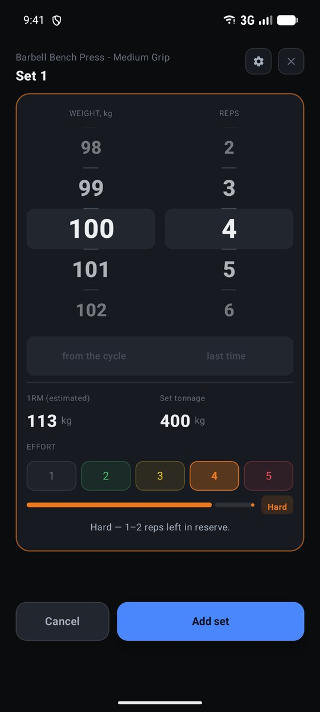</td>
    <td>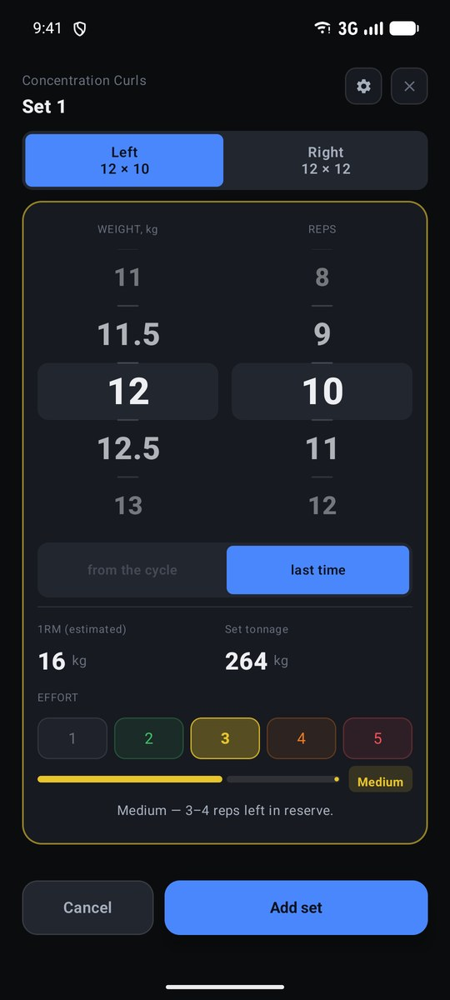</td>
    <td>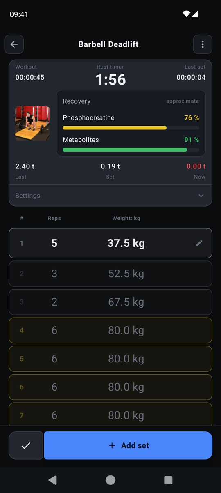</td>
  </tr>
  <tr>
    <td><b>Add a set.</b> Two wheels for weight and reps, prefilled from the cycle, from last session or from the warm-up ramp. Rate the effort 1–5 (1 is a warm-up); it drives the smart rest timer and the workout’s difficulty.</td>
    <td><b>Left and right.</b> For one-arm and one-leg exercises “Add set” has Left and Right tabs. The weaker side counts for 1RM, records and cycles; tonnage adds both.</td>
    <td><b>Rest and recovery.</b> The rest timer is a real alarm — it rings with the phone in your pocket. During the rest, an approximate model shows how much phosphocreatine and how much of the metabolite load has recovered.</td>
  </tr>
  <tr>
    <td>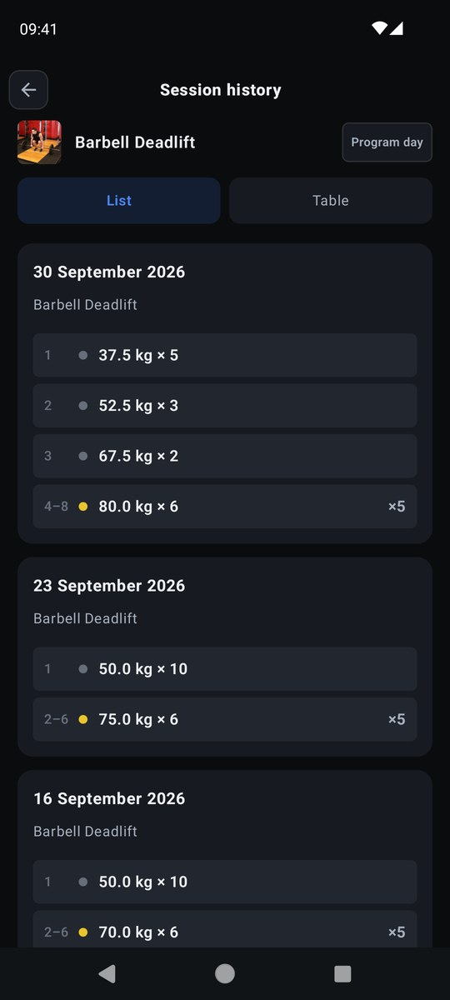</td>
    <td>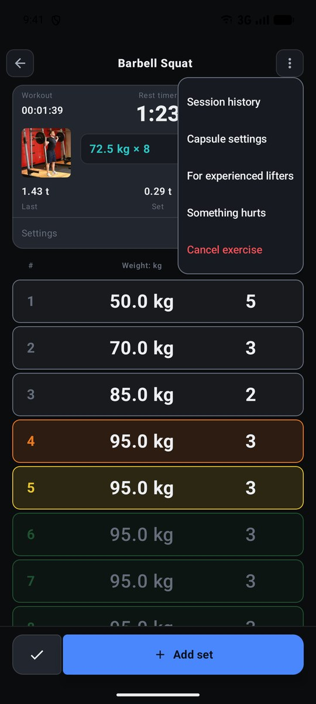</td>
    <td>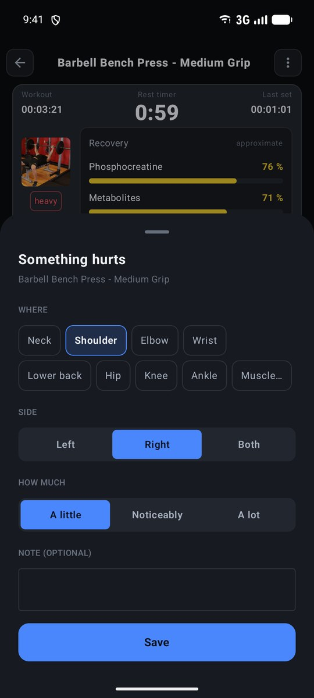</td>
  </tr>
  <tr>
    <td><b>Session history.</b> Every previous session of this exercise as a list or as a table, one tap away from the exercise screen.</td>
    <td><b>Exercise menu.</b> Destructive actions live behind ⋮ and ask first — a long press never performs an action. Hold a set to edit or delete it, with Undo; a tap adds a new set with the same numbers.</td>
    <td><b>Something hurts.</b> Mark a joint or a muscle and how much it hurts. Every exercise that loads that spot reminds you of it until you tap “It’s gone”; “A lot” comes with “see a doctor”.</td>
  </tr>
  <tr>
    <td>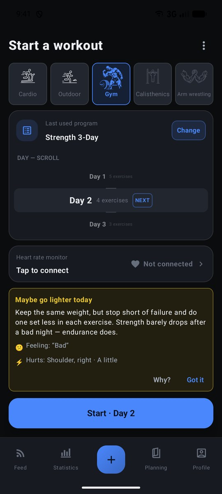</td>
    <td>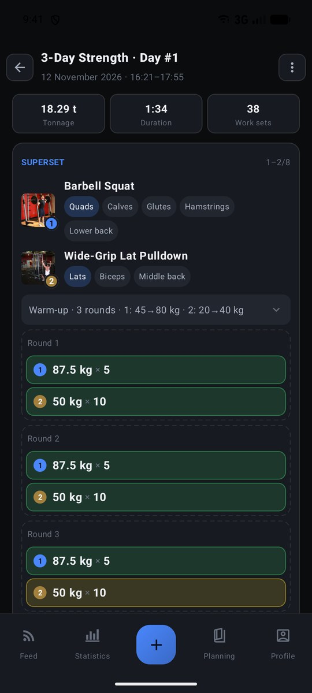</td>
    <td></td>
  </tr>
  <tr>
    <td><b>Readiness.</b> Your answer to “How are you today?”, a pain note, short sleep, or two hard workouts with falling numbers — when something is off, a card suggests going lighter and says why.</td>
    <td><b>A superset as one card.</b> Exercises numbered 1, 2, 3 and the sets shown in rounds — in your workout overview and in a friend’s post.</td>
    <td><b>Warnings and tips.</b> Too many sets for one muscle in a workout, too few in a week, the tip of the day, deadlift, bench and squat hints — each with its own switch and its real card.</td>
  </tr>
</table>

**Smart helpers** (all optional, all switchable under *For experienced lifters*):

- **Smart rest timer** — the pause is computed from the set you just logged: 90 s after a warm-up, 2 min over 8 reps, 3 min at 5–8, 4 min at 4 or fewer, two thirds of that for an isolation exercise; ±1 min for “hard”/“easy”. In a superset the rest starts only when the round is closed.
- **Smart warm-up** — a ramp to today’s working weight that depends on the working reps, ending with a heavy single or double for low-rep work; skipped when another exercise has already warmed the same muscle.
- **Time under load** — the time your muscles spend under the bar, from each set’s start and finish.

---

## Cardio and runs

Indoor machines and outdoor runs are part of the same workout as your sets.

<table>
  <tr>
    <td width="33%">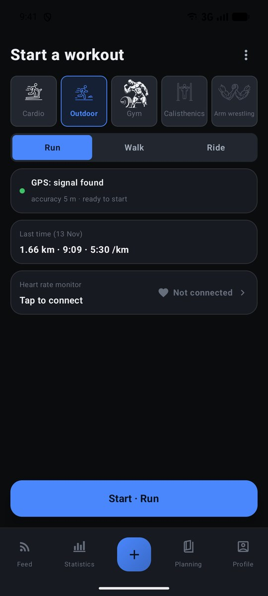</td>
    <td width="33%">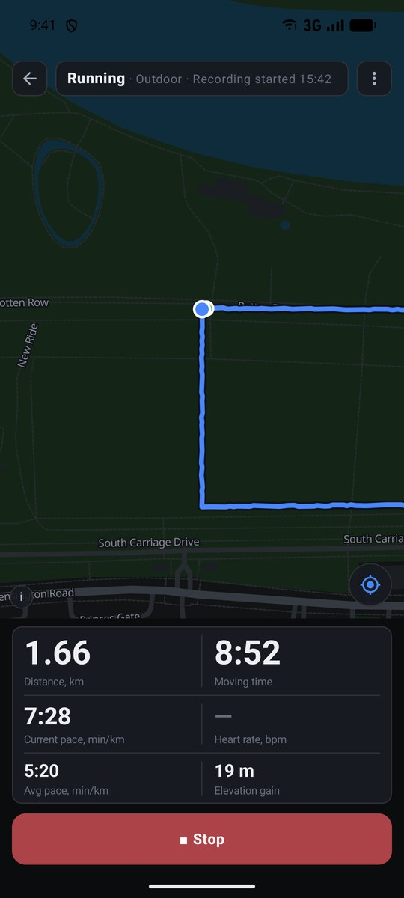</td>
    <td width="33%"></td>
  </tr>
  <tr>
    <td><b>Outdoor.</b> Running, walking or cycling. The card shows whether GPS has a fix; you can start before it does and the route begins with the first fix.</td>
    <td><b>Recording.</b> The map follows you, with distance, moving time, current and average pace, heart rate and climb. The notification has Pause, and if Android closes the app, what was recorded stays.</td>
    <td><b>Run summary.</b> The route on a map, the time of every kilometre, an elevation profile (barometer when the phone has one) and time in heart-rate zones.</td>
  </tr>
  <tr>
    <td>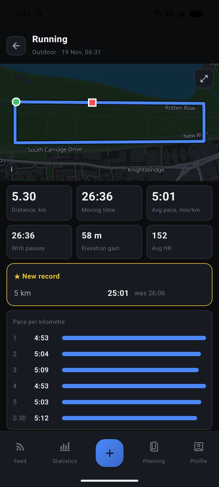</td>
    <td>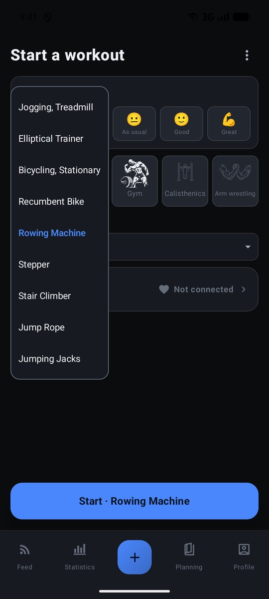</td>
    <td>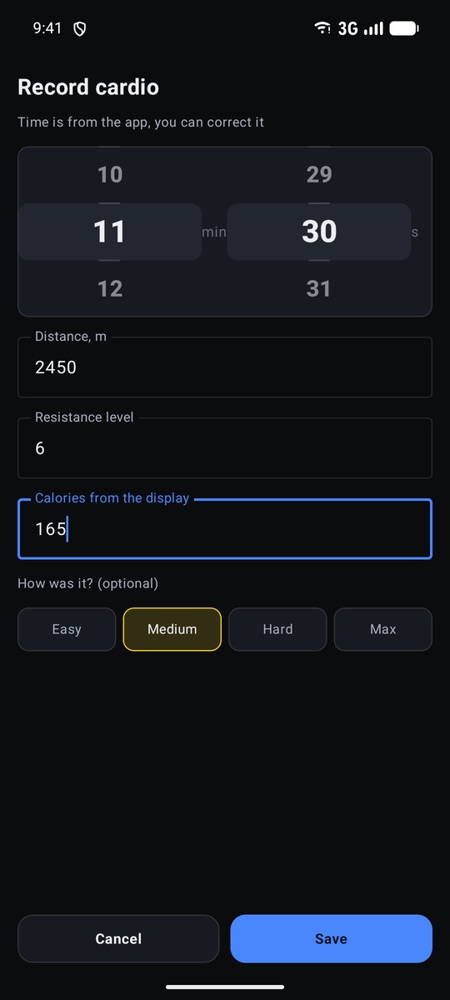</td>
  </tr>
  <tr>
    <td><b>A run.</b> The route, pace per kilometre, climb and heart rate — and “★ New record” when a stretch of this run beats your earlier best.</td>
    <td><b>Indoor cardio.</b> Treadmill, elliptical, stationary and recumbent bikes, rowing machine, stepper, stair climber, jump rope. Start it from the Cardio tile, or add it to a gym workout with “Add cardio”.</td>
    <td><b>After Finish.</b> The stopwatch runs while you train; afterwards enter what the machine showed — distance, level, calories. Effort is graded by your heart-rate zones.</td>
  </tr>
</table>

Runs show up in history, the calendar and your post for friends. Turn off *Show friends the route of my runs* and friends see only the distance and time. How the tracker filters GPS noise and counts pace and climb is in the *GPS accuracy* guide.

---

## Workout summary and history

<table>
  <tr>
    <td width="33%">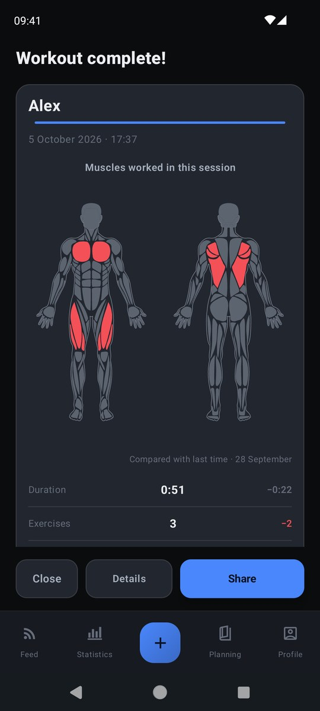</td>
    <td width="33%">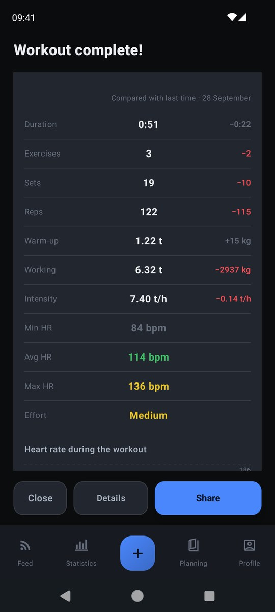</td>
    <td width="33%">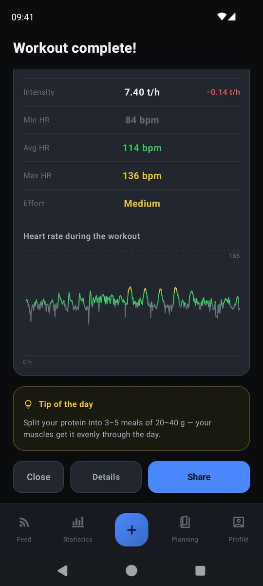</td>
  </tr>
  <tr>
    <td><b>Workout complete.</b> The muscles you trained, highlighted on a body map. The framed part can be shared as an image.</td>
    <td><b>Compared with last time.</b> Duration, exercises, sets, reps, warm-up and working tonnage, intensity and heart rate — against the previous session of the same program day, never another day.</td>
    <td><b>Heart rate and tip of the day.</b> The heart-rate curve coloured by your zones, and below the summary — the day’s tip.</td>
  </tr>
  <tr>
    <td>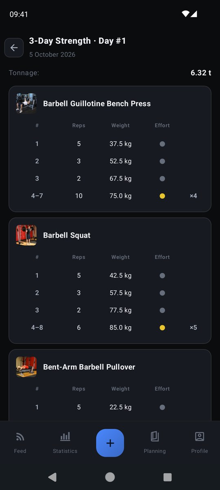</td>
    <td>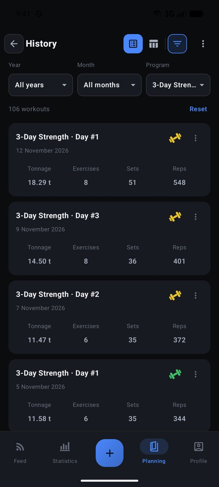</td>
    <td>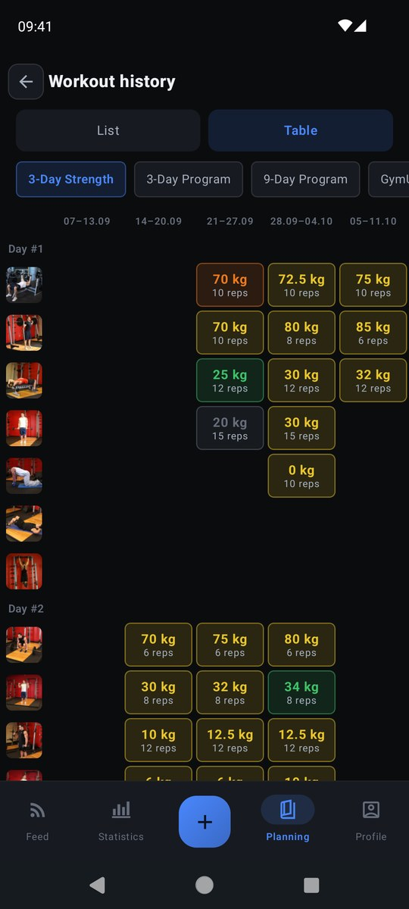</td>
  </tr>
  <tr>
    <td><b>Workout details.</b> Every set with its weight, reps and effort; repeated sets are collapsed into one line.</td>
    <td><b>Workout history</b> as a list of cards, filtered by year, month and program…</td>
    <td>…or as a <b>table</b>: one row per exercise, one column per week — a whole program on one screen.</td>
  </tr>
</table>

A finished workout can be reopened for 30 minutes — for the set you forgot or the “Finish” you tapped by accident. Later on, “Edit workout” in ⋮ fixes its sets, exercises and time.

---

## Planning

<table>
  <tr>
    <td width="33%">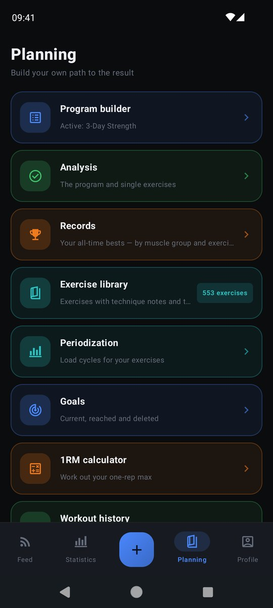</td>
    <td width="33%">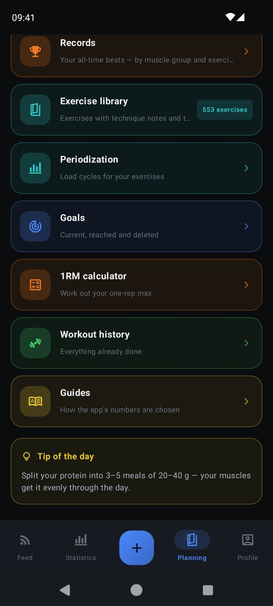</td>
    <td width="33%">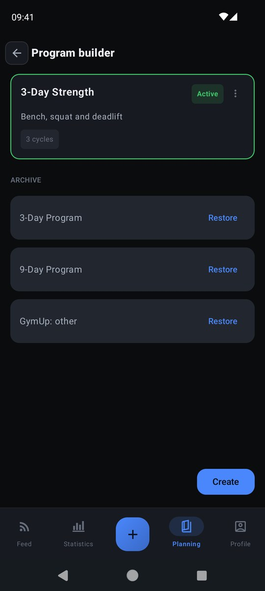</td>
  </tr>
  <tr>
    <td><b>Planning hub.</b> Programs, analysis, records, totals, the exercise library, periodization, goals, a 1RM calculator, history, your gym and guides. Hold a tile for two seconds and drag to reorder.</td>
    <td><b>Tip of the day</b> at the bottom of the hub.</td>
    <td><b>Programs.</b> The current program, ready-made programs and the archive. A program with history is archived, never deleted — your workouts stay.</td>
  </tr>
  <tr>
    <td>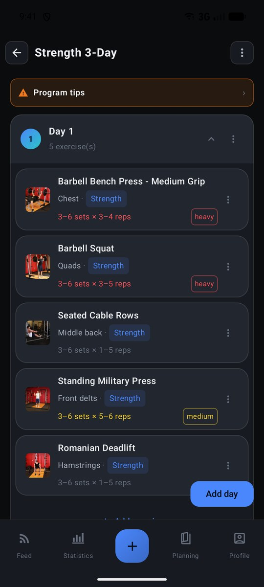</td>
    <td>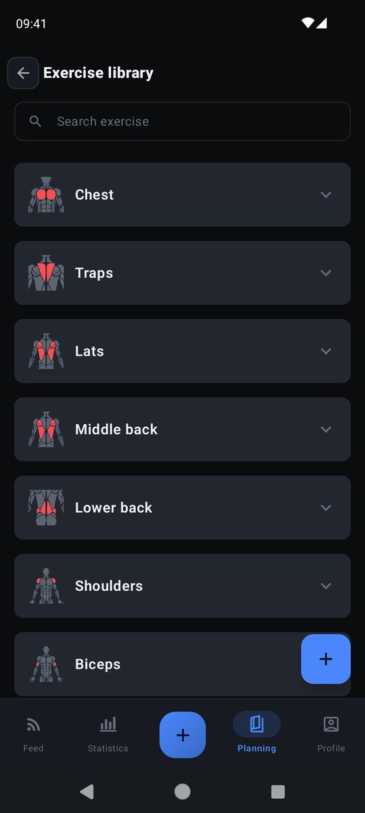</td>
    <td>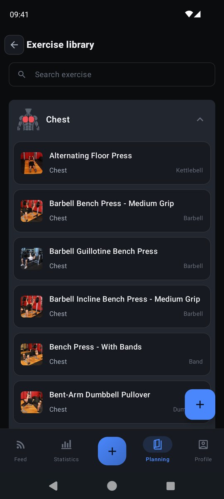</td>
  </tr>
  <tr>
    <td><b>Program days.</b> Days with their exercises, drag to reorder, supersets made by holding one exercise over another, alternatives for each slot, and “Copy to another day” in ⋮. Each exercise shows its goal, its set and rep range and a heavy / medium / light badge.</td>
    <td><b>Exercise library.</b> 550 exercises grouped by muscle, with search, plus your own exercises — compound or isolation, with two photos, the sport, secondary muscles and the equipment. “Only my exercises” lists just yours.</td>
    <td><b>A muscle group</b> — every exercise with a start-and-finish photo and its equipment.</td>
  </tr>
  <tr>
    <td>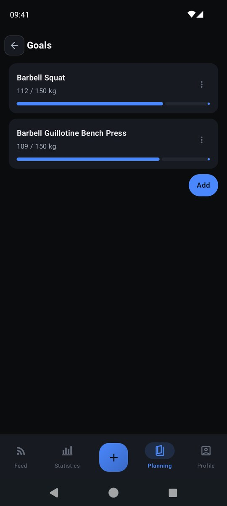</td>
    <td>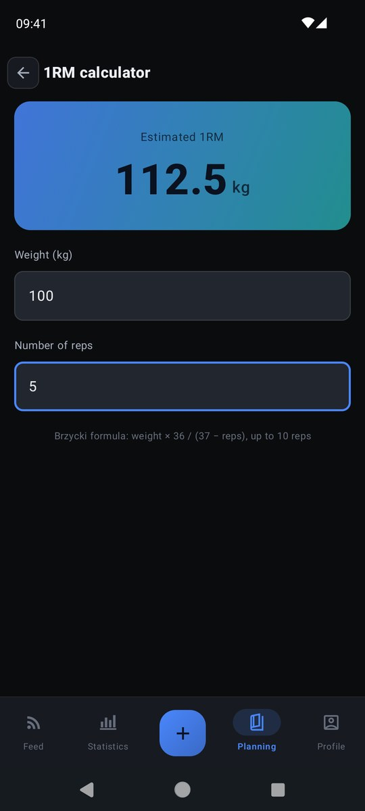</td>
    <td>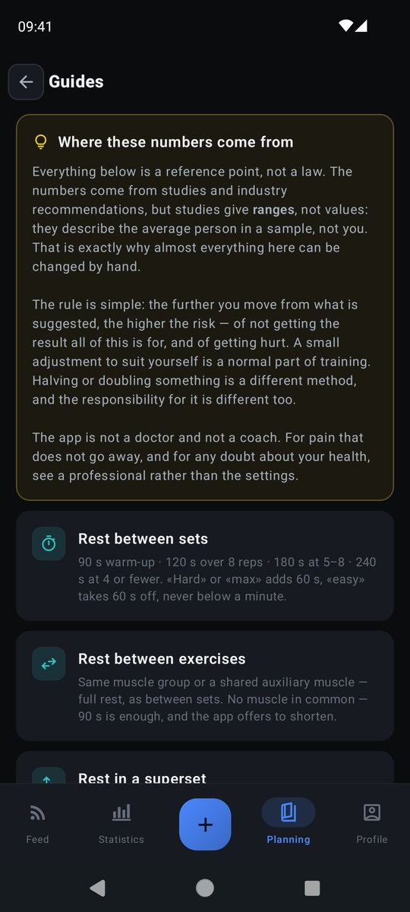</td>
  </tr>
  <tr>
    <td><b>Goals</b> — current, reached (with the date) and deleted.</td>
    <td><b>1RM calculator.</b> Brzycki, up to 10 reps — and only up to 10.</td>
    <td><b>Guides.</b> Every number the app uses — rest, warm-up, the cycle’s percentages, deloads, breaks, the 1RM ceiling, difficulty — with its sources.</td>
  </tr>
  <tr>
    <td>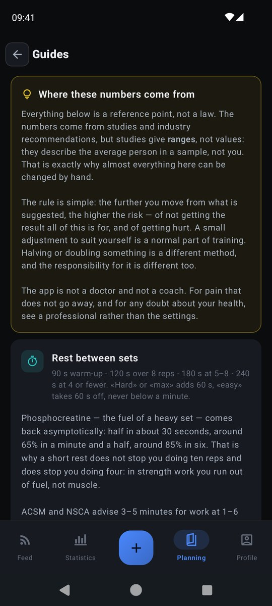</td>
    <td>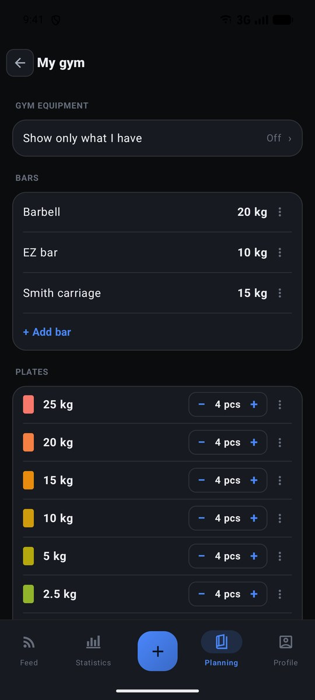</td>
    <td>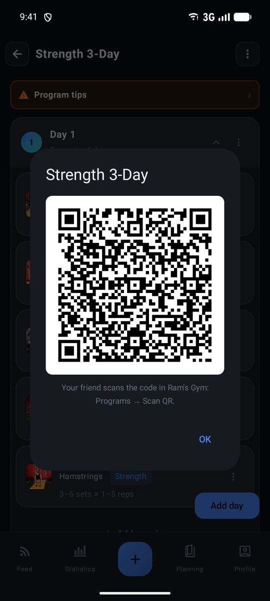</td>
  </tr>
  <tr>
    <td><b>A guide.</b> What the number is, why this number, what breaks if you change it, and where it comes from.</td>
    <td><b>My gym.</b> The bars and plates you have. The plate calculator in “Add set” loads the fewest plates and never more than exist; the exercise list can show only what your gym has.</td>
    <td><b>Share a program</b> by link, QR code, file or straight to a friend in the app. Your weights, history and cycles stay with you.</td>
  </tr>
  <tr>
    <td>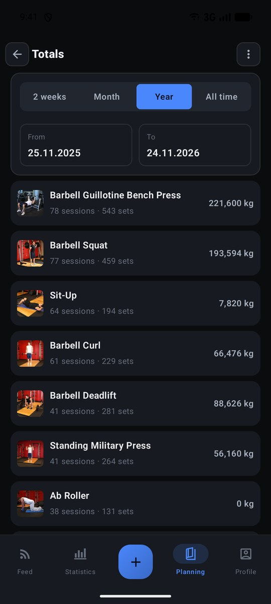</td>
    <td>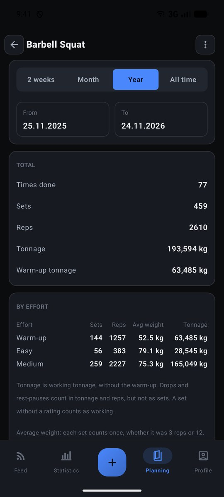</td>
    <td>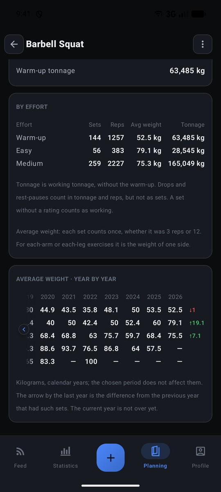</td>
  </tr>
  <tr>
    <td><b>Totals.</b> Every exercise you did over 2 weeks, a month, a year, all time or your own dates — sessions, sets and working tonnage.</td>
    <td><b>An exercise’s totals.</b> Sets, reps, average weight and tonnage for each effort rating, from warm-up to max. Shown as a table, a share bar or tiles; wide tables scroll sideways.</td>
    <td><b>Year by year.</b> The average set weight for each rating in every calendar year, with the change against the previous year — is your “medium” heavier than it used to be?</td>
  </tr>
</table>

---

## Program wizard

Pick a goal and the number of days, and the wizard suggests which exercises go on which day, how many sets and at what weight. Its norms come from the app’s two handbooks; every number is recomputed from the real days on each change.

<table>
  <tr>
    <td width="33%">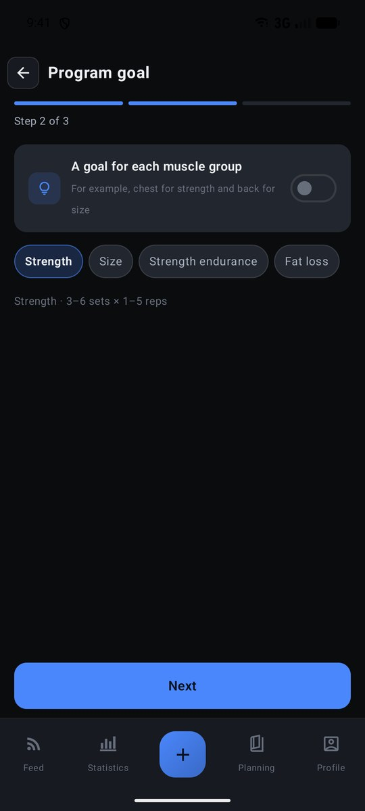</td>
    <td width="33%">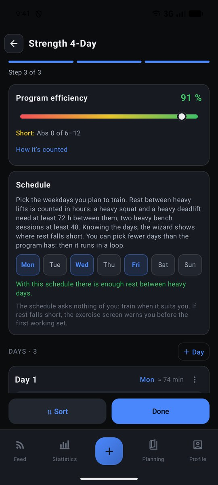</td>
    <td width="33%">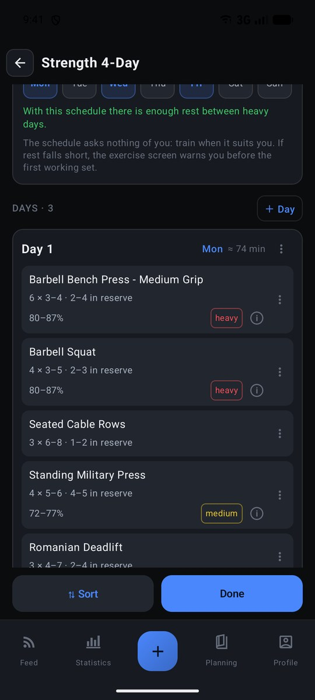</td>
  </tr>
  <tr>
    <td><b>Goal.</b> Strength, size, strength endurance or fat loss — for the whole program or for each muscle group.</td>
    <td><b>Efficiency and schedule.</b> The scale shows how close the program comes to the norms and what is short. Pick the weekdays and the wizard checks the rest between heavy days; pick fewer days than the program has and it runs in a loop.</td>
    <td><b>Days.</b> Every exercise with its dose — sets × reps, reps in reserve, % of your max — and a heavy, medium or light badge. For strength: the competition bench twice a week, the third press a variation.</td>
  </tr>
</table>

Red advice never blocks you: the program stays yours.

---

## Load cycles (periodization)

A load cycle is one row of settings; the plan is computed from it, never stored. Its unit is the **executions of the exercise**, not weeks — how long it takes depends on how often you train.

Three models:

- **Percent of working weight** — light, medium and heavy sessions (80 / 90 / 100 % by default, editable) with a step up every few cycles at a rate computed from your training age and how far you are below your own record.
- **Wave** — the weight climbs step by step to a ceiling, takes it one to three times with more reps each time, then rolls back and starts the next wave higher. The rollback *is* the deload.
- **Effort wave** — plans how hard the last working set is (reps in reserve), not the weight; the weight is only suggested from your 1RM.

<table>
  <tr>
    <td width="33%"></td>
    <td width="33%"></td>
    <td width="33%"></td>
  </tr>
  <tr>
    <td><b>Program plan.</b> Columns are passes through the program, rows are exercises; colour goes from light (green) to heavy (red). Switch to <i>Actual</i> to see what was really lifted, or <i>Check</i> to credit work done before the cycle.</td>
    <td><b>Progression.</b> One exercise in real kilograms: a row is a weight step, a column is a cycle — the shape of the method is visible at a glance.</td>
    <td><b>Edit cycle.</b> Model, the days the wave runs in (a day can be taken off the wave and given a lighter replacement), goal type and the start.</td>
  </tr>
  <tr>
    <td></td>
    <td></td>
    <td></td>
  </tr>
  <tr>
    <td><b>Goal and pace.</b> 1RM or weight-for-reps, a start and a target; the app recommends how many cycles that takes and roughly how long, and says so plainly.</td>
    <td><b>Wave settings.</b> Sessions on the climb, the weight increment of your bar, how many times to take the top weight, and the reps of every session.</td>
    <td><b>Effort wave.</b> Plans how hard the last working set is — easy, medium, hard or to failure — and suggests the weight from your 1RM. It offers to shift the wave by how you rated that set, never by weight alone.</td>
  </tr>
</table>

Exercises that share muscles and a training day can run **in antiphase** so their ceilings don’t meet; ceilings of three or more cycles in one pass can be **staggered**. After a break of 2–4 weeks the card offers to restart from the lightest session of the wave; after more than four weeks it asks for a new starting weight instead of guessing.

---

## Analysis

<table>
  <tr>
    <td width="33%"></td>
    <td width="33%"></td>
    <td width="33%"></td>
  </tr>
  <tr>
    <td><b>Analysis</b> of a program or of a single exercise.</td>
    <td><b>Program analysis.</b> One goal for the whole program — or a goal for each muscle group. Weekly sets first, then reps, sets per workout and rest, each on a red–yellow–green line that shows where you stand. Counted from what you actually did in the last 7, 14, 28 days or 3 months, not from the template.</td>
    <td><b>Heavy and light days.</b> A strength exercise trained heavy one day and light the next is split by reps: heavy sessions are measured as strength, light ones as size — so the light day no longer spoils the strength numbers. Per week or per program pass, in the ⋮ menu.</td>
  </tr>
  <tr>
    <td></td>
    <td></td>
    <td></td>
  </tr>
  <tr>
    <td><b>Exercise analysis.</b> Any exercise across all programs and any date range: sessions, working sets, how often you train it, and a progress chart of the heaviest weight and the estimated 1RM.</td>
    <td><b>By year</b> — sessions, sets in each rep range, the heaviest weight and the best 1RM.</td>
    <td><b>Weight and 1RM records</b>, high-rep sets and the breaks in your history.</td>
  </tr>
</table>

---

## Records

All-time bests — over the whole history or for one muscle group, plus the fastest stretches of your runs and rides. Only working sets of finished workouts count; for equal results the first one holds the record. Tap a record to open the workout where it was set.

<table>
  <tr>
    <td width="33%"></td>
    <td width="33%"></td>
    <td width="33%"></td>
  </tr>
  <tr>
    <td><b>All-time records.</b> Heaviest weight, most reps in a set, tonnage per exercise and per set — for all muscles or one group.</td>
    <td><b>Heaviest weight for N reps</b> — 1 to 10, then 15 and 20: the heaviest set done for at least that many reps.</td>
    <td><b>Compare exercises.</b> Pick any exercises — barbell curls against a triceps press, say — and the estimated 1RM bars show which muscle is stronger.</td>
  </tr>
  <tr>
    <td></td>
    <td></td>
    <td></td>
  </tr>
  <tr>
    <td><b>Picking exercises</b> from your history, with search.</td>
    <td>Rep maxes for the high-rep end of the table.</td>
    <td><b>Cardio records.</b> Your fastest 1, 5 and 10 km, half marathon and longest run — 10, 20 and 40 km on the bike — found inside every track. A record counts only when it beats an earlier run; tap it to open that run.</td>
  </tr>
</table>

---

## Feed and friends

<table>
  <tr>
    <td width="33%"></td>
    <td width="33%"></td>
    <td width="33%"></td>
  </tr>
  <tr>
    <td><b>Runs in the Feed.</b> The route map, distance, time and pace, the records the run set and an effort marker from heart-rate zones. The map can be switched off in the feed card settings.</td>
    <td><b>Feed.</b> Your workouts and your friends’, newest finished first: tonnage, exercises, sets, reps, difficulty, photos, heart rate and runs. Like, comment or react while a friend is still training; a bell shows new workouts, likes and comments.</td>
    <td><b>Friends.</b> Friendship is mutual — find a person by name or by an 8-character friend code, shown as a QR code or sent as a link.</td>
  </tr>
  <tr>
    <td></td>
    <td></td>
    <td></td>
  </tr>
  <tr>
    <td><b>Account.</b> Only needed for friends and the feed. Your workouts stay on the phone either way; signing out keeps everything.</td>
    <td><b>Appearance.</b> Theme, capsule, what the workout overview and the feed card show, and which tips the app gives.</td>
    <td><b>A live preview.</b> Every switch changes a real card on made-up numbers right above it, so you see what you turn off.</td>
  </tr>
</table>

While a friend trains, their card in the Feed is live: what they are doing right now — gym, cardio or outdoors — and the exercise they are on. Send a reaction, a GIF or a photo into the conversation under the workout.

A published workout is a snapshot: exercises, sets with their rest and heart rate, photos and runs — never your program, days or cycles. The *What they see* tab in Friends decides what leaves the phone: what you’re doing live, new workouts and run routes. From one friend you can hide more (⋮ next to them → *What … sees*); they won’t know something is hidden.

---

## Profile and settings

<table>
  <tr>
    <td width="33%"></td>
    <td width="33%"></td>
    <td width="33%"></td>
  </tr>
  <tr>
    <td><b>Profile.</b> Age (from your date of birth), weight, height, account, friends, privacy, health data and settings.</td>
    <td><b>Settings.</b> Experienced-lifter features, appearance, notifications, maps and language.</td>
    <td><b>Theme.</b> Dark or light, any accent colour from a slider — the whole palette is generated from one hue with readable contrast at every point.</td>
  </tr>
  <tr>
    <td></td>
    <td></td>
    <td></td>
  </tr>
  <tr>
    <td><b>Smart timer.</b> Every rest duration is yours to change.</td>
    <td><b>Capsule.</b> What stays in the collapsed capsule on the exercise screen — one row or two, any field in any position.</td>
    <td><b>Heart-rate zones.</b> Five zones as in Polar and Garmin, from your own maximum or 220 − age; a resting heart rate switches to Karvonen.</td>
  </tr>
  <tr>
    <td></td>
    <td></td>
    <td></td>
  </tr>
  <tr>
    <td><b>Notifications.</b> The sound of the rest signal and reminders before your training days.</td>
    <td><b>Language.</b> English, Ukrainian or German — exercise names follow the language too.</td>
    <td><b>Health and data.</b> Training experience, backups, and a full reset.</td>
  </tr>
  <tr>
    <td></td>
    <td></td>
    <td></td>
  </tr>
  <tr>
    <td><b>Training experience.</b> Years and records for the bench, squat and deadlift — answered once, used to set the pace of every cycle.</td>
    <td><b>Backups.</b> An automatic copy after every workout into Downloads (or a folder of your choice, Google Drive included), restore, and import from GymUp, Strong, Hevy and FitNotes.</td>
    <td><b>Maps.</b> Download an area to see the map without a connection, choose whether the map may use mobile data, and refresh areas once a month over Wi‑Fi.</td>
  </tr>
  <tr>
    <td></td>
    <td></td>
    <td></td>
  </tr>
  <tr>
    <td><b>Body.</b> Weight with a 7-day average and the pace towards your weight goal, and measurements with photos. A weigh-in from Health Connect is offered, never written in silently.</td>
    <td><b>Build.</b> From your height and wrist: the frame size and, for men, Casey Butt’s estimate of the drug-free limit — weight, lean mass and each girth next to your latest measurement.</td>
    <td><b>For experienced lifters.</b> One switch that hides and disables the smart warm-up, smart rest, time under load and load cycles — and brings them back untouched.</td>
  </tr>
</table>

---

## Install and update

1. Download the APK from the [latest release](https://github.com/Ramzesp2009/ramsgym-realses/releases/latest).
2. Open it on your phone and allow installing from this source when Android asks.
3. That’s it. The app checks for new versions once a day (or on demand: *Settings → Check for updates*) and installs them from this page; you get a notification when a new version is out.

Requires Android 10 or newer. Updates install only over a build signed with the same key, so always update from this page.

## Privacy

- Your training data is stored on your phone. There are no ads and no analytics trackers.
- The server (Supabase) holds only what the social part needs: your account, profile name and friend code, friendships, published workouts, likes and comments. Your profile photo is visible to anyone signed in. What you hide from a friend in *What they see* is withheld by the server itself, not by the friend’s phone.
- Health Connect is only read — sleep, steps, calories, resting heart rate and weight — and nothing from it is stored.
- Map tiles come from OpenFreeMap. Your GPS track stays on the phone; a run's route reaches friends only in a published workout, and *What they see* can turn that off.
- Backups are files you own — in your Downloads folder or wherever you put them.

## License

[CC BY-NC 4.0](https://creativecommons.org/licenses/by-nc/4.0/) — free for non-commercial use with attribution.

Exercise data is based on [free-exercise-db](https://github.com/yuhonas/free-exercise-db) (Unlicense).

*Screenshots show demo data.*
